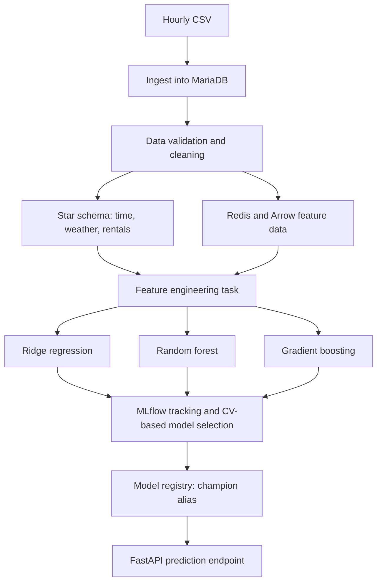
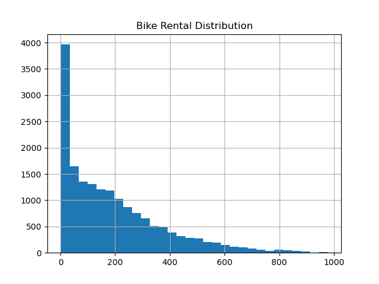
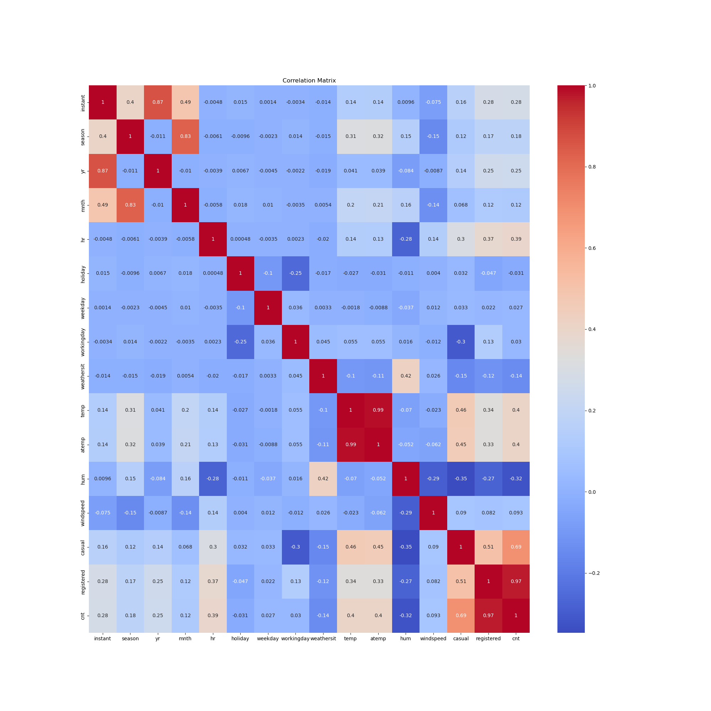

# Bike Sharing Demand Prediction | End-to-End MLOps

An academic team project that predicts hourly bicycle rental demand using historical weather and calendar data. The system connects data ingestion, a relational warehouse, Redis-backed feature processing, automated model training, experiment tracking and a REST prediction service.

**Dataset:** Capital Bikeshare, Washington, D.C. (2011–2012) · **17,379 hourly observations** · **Task:** regression

## Architecture



Apache Airflow orchestrates the tasks. The star schema is persisted in MariaDB for analytical use; feature engineering reads cleaned records from Redis, rather than querying the fact table. The optional XGBoost script is retained but is not part of the original DAG.

## Technology stack

| Layer | Technology |
|---|---|
| Data engineering | Python, pandas, MariaDB, SQLAlchemy, Redis, Apache Arrow |
| Orchestration | Apache Airflow 2.10.5 |
| Machine learning | scikit-learn, GridSearchCV; optional XGBoost |
| Experiment tracking | MLflow 3.11.1 and model registry |
| Serving | FastAPI, Pydantic, Uvicorn |
| Local infrastructure | Docker Compose (MariaDB and Redis) |

The original academic environment used MariaDB ColumnStore. This portfolio package provides a standard MariaDB service for simpler local reproduction; it does not reproduce a ColumnStore deployment.

## Data engineering and modelling

- Ingestion imports the hourly CSV into `raw_dataset`. Validation reports missing values, duplicates and schema information.
- Cleaning extracts the day of month, renames fields, writes `cleaned_dataset` to MariaDB and serializes records into Redis using Arrow.
- The warehouse creates `dim_time`, `dim_weather` and `fact_rentals`.
- Feature engineering removes record identifiers and the date column. Model inputs exclude `cnt`, `casual` and `registered` to avoid target leakage.
- The three primary algorithms use the same reproducible random 80/20 split (seed 42) and three-fold grid search on training data. The revised selection stage ranks models by training cross-validation R², registers the winner under `BikeShare_Best_Model@champion` and records its held-out metrics.

## Original experiment results

The following are held-out test metrics extracted from the original archived MLflow runs. These are historical observations, **not a fresh benchmark of the updated repository**.

| Model | R² (higher is better) | MAE | RMSE |
|---|---:|---:|---:|
| Ridge regression | 0.3880 | 104.79 | 139.20 |
| **Random forest** | **0.9458** | **24.58** | **41.44** |
| Gradient boosting | 0.9372 | 28.40 | 44.61 |

Random forest achieved the strongest archived held-out result. The original selection script also recorded R² = 0.9836 by predicting on the entire feature dataset, including training samples; that value is not a valid independent test score and is not used as the headline result. Ridge originally used different weather units; the updated code standardises units across models and serving. Retrain to obtain metrics for the revised code.

Raw historical values: [`docs/archived_metrics.csv`](docs/archived_metrics.csv).

## Exploratory data analysis

The original EDA notebook and exported plots are retained. Notebook execution outputs have been cleared to remove potentially sensitive connection details.





## Repository layout

```text
bike-sharing-mlops-pipeline/
├── bike_share/              # Original UCI daily/hourly CSVs and dataset attribution
├── bike_eda_output/          # Original EDA plots and statistics
├── bike_share_eda.ipynb      # EDA notebook
├── dags/                    # Airflow workflow
├── src/                     # Pipeline stages, training and shared configuration
├── fastapi/modelAPI.py       # Prediction API
├── docs/                    # Historical metrics and preparation notes
├── tests/                   # Feature contract test
├── compose.yaml             # Local MariaDB and Redis
├── .env.example             # Configuration template (no real credentials)
├── .gitignore
├── requirements.txt
└── requirements-airflow.txt
```

## Local setup

Use Python 3.10, Docker with Compose, and a terminal in the repository root. For Airflow use Linux or WSL2 (Windows users); the native Windows quick-start below uses the same pipeline stages without Airflow. The commands assume a fresh environment. The original large trained models and MLflow databases are intentionally omitted; training is required before serving predictions.

### 1. Create an environment

Linux/WSL:

```bash
python3.10 -m venv .venv
source .venv/bin/activate
python -m pip install --upgrade pip
python -m pip install -r requirements.txt
```

Windows PowerShell (without Airflow):

```powershell
py -3.10 -m venv .venv
.\.venv\Scripts\Activate.ps1
python -m pip install --upgrade pip
python -m pip install -r requirements.txt
```

If running Airflow, install it in the Linux/WSL environment. Airflow recommends its release-specific constraints during installation; the second command resolves the project dependencies while keeping the Airflow version pinned. Check for dependency conflicts before proceeding.

```bash
python -m pip install "apache-airflow==2.10.5" --constraint "https://raw.githubusercontent.com/apache/airflow/constraints-2.10.5/constraints-3.10.txt"
python -m pip install -r requirements-airflow.txt
python -m pip check
```

The full dependency combination has not been installed and integration-tested in this packaging environment. If a conflict occurs, inspect pip's resolver output before changing versions.

### 2. Configure local services

Copy `.env.example` to `.env` (`cp .env.example .env` on Linux/WSL or `Copy-Item .env.example .env` on PowerShell). Replace both placeholder database passwords and update `DATABASE_URL` to match the MariaDB user password. URL-encode any reserved characters in the URL. Do not commit `.env`.

```bash
docker compose up -d
docker compose ps
```

The database and Redis are bound to localhost. Use only this dedicated local database: the coursework pipeline replaces its target tables on each run. If using WSL, ensure the Docker services are reachable from that same environment.

### 3. Start MLflow (separate terminal)

Activate the same virtual environment, remain in the project root, and run:

```bash
mlflow server --backend-store-uri sqlite:///mlflow.db --artifacts-destination ./mlartifacts --host 127.0.0.1 --port 5000
```

Open <http://127.0.0.1:5000> to view experiments and the model registry. The API and training scripts read the same `MLFLOW_TRACKING_URI` from `.env`.

### 4. Run the pipeline

**Option A – Airflow (Linux/WSL2):** with the Airflow dependencies installed, open another terminal and activate the virtual environment:

```bash
export AIRFLOW_HOME="$PWD/airflow"
export AIRFLOW__CORE__DAGS_FOLDER="$PWD/dags"
export AIRFLOW__CORE__LOAD_EXAMPLES=False
airflow standalone
```

Open <http://127.0.0.1:8080>, log in with the credentials printed by Airflow, enable `bike_ml_pipeline` and trigger it manually. Wait for all nine tasks to succeed. Grid search may take several minutes or longer depending on hardware.

**Option B – Direct execution (Windows/Linux):** run the same pipeline stages sequentially without Airflow:

```bash
python -m src.run_pipeline
```

When completed, check MLflow for `BikeShare_Best_Model` and its `champion` alias. The direct runner is an alternative for local testing, not a replacement for the Airflow workflow.

### 5. Start the REST API (separate terminal)

```bash
python -m uvicorn modelAPI:app --app-dir fastapi --host 127.0.0.1 --port 8000
```

Open <http://127.0.0.1:8000/docs> for Swagger UI.

| Method | Path | Description |
|---|---|---|
| GET | `/` | API service information |
| POST | `/predict` | Predict the hourly rental count |

Example JSON body for `/predict`:

```json
{
  "season": 2,
  "yr": 1,
  "mnth": 5,
  "day": 15,
  "hr": 17,
  "holiday": 0,
  "weekday": 2,
  "workingday": 1,
  "weather_situation": 1,
  "temp": 22.0,
  "atemp": 24.0,
  "hum": 55.0,
  "windspeed": 12.0
}
```

The API expects Celsius temperature and apparent temperature, relative humidity in percent and wind speed in the dataset's rescaled units (normalised value × 67). The year feature is historical: 0 = 2011, 1 = 2012. The response contains `predicted_count` and the submitted input. If no champion model is available, the endpoint returns HTTP 503; train/register the model first. Restart the API after retraining to reload the cached model.

### 6. Run the notebook and tests

From the root, with database services running:

```bash
jupyter notebook bike_share_eda.ipynb
```

To run the feature-contract test (no database or tracking server required):

```bash
python -m pytest -q
```

To stop local services when finished, use `docker compose down`. This preserves the MariaDB volume; do not use `-v` unless you intend to delete its data.

## Limitations and next steps

- The historical dataset is not representative of current rental demand. A chronological train/validation/test split would be more appropriate for forecasting future time periods than the existing random split.
- No production deployment, authentication, live monitoring or automated drift detection is claimed.
- Redis keys are shared by the local pipeline; the DAG limits active runs to one. Do not run the direct runner concurrently with the DAG.
- A full reproducibility and service integration test is still needed after installing the dependencies on a suitable machine.
- Future improvements include integration tests, time-based evaluation, explicit data quality checks and deploying a prediction interface.

## Credits and data attribution

Developed as a university team project at Birmingham City University. The original workflow credits Thenul, Disha, Subhan and Harsh. The portfolio preparation preserves the original team's core work; no exclusive individual authorship is claimed. Confirm permission to publish the group code and record each contributor's verified role before sharing publicly.

Data: Hadi Fanaee-T, *Bike Sharing*, UCI Machine Learning Repository (2013), DOI [10.24432/C5W894](https://doi.org/10.24432/C5W894). The [UCI dataset page](https://archive.ics.uci.edu/dataset/275/bike+sharing+dataset) lists the dataset under [CC BY 4.0](https://creativecommons.org/licenses/by/4.0/). Original CSVs are included unchanged; derived plots and feature transformations are identified above. See [`bike_share/Readme.txt`](bike_share/Readme.txt) for the original attribution and citation.

Associated paper: Fanaee-T, H. and Gama, J., *Event labeling combining ensemble detectors and background knowledge*, Progress in Artificial Intelligence (2013), [doi:10.1007/s13748-013-0040-3](https://doi.org/10.1007/s13748-013-0040-3).

The dataset license is distinct from the project code. No code license is assigned here pending agreement among contributors.
